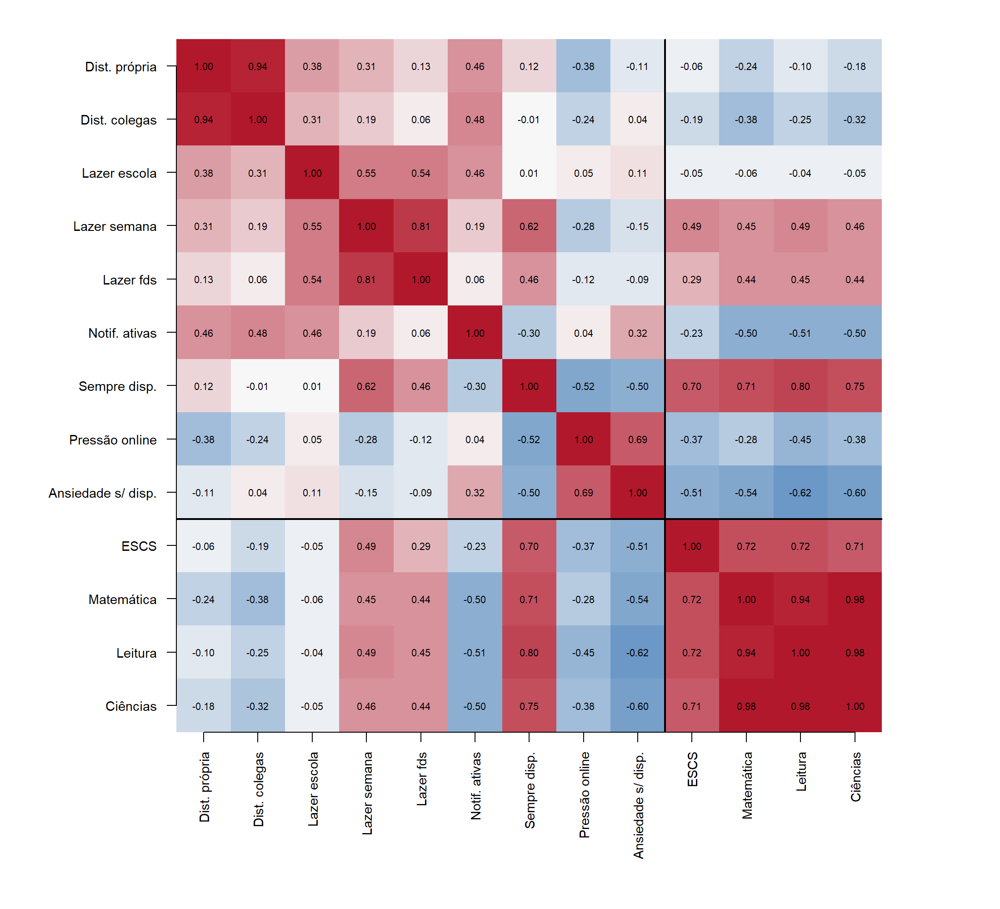

## 2. Dados

### 2.1 Fonte

Os dados vêm do **PISA 2022** (OCDE, 2023a), aplicado a 613.744 estudantes de 80 países e economias. Foi usado o arquivo do questionário do estudante (`CY08MSP_STU_QQQ`), distribuído pela OCDE em formato SPSS. Para este trabalho, li uma cópia do mesmo arquivo em formato *parquet*, mantida num repositório público, porque o servidor da OCDE estava inacessível no ambiente de processamento. O script de agregação (Apêndice A) aceita os dois formatos, e as médias de Matemática obtidas coincidem com as publicadas pela OCDE (por exemplo, Brasil 379, Singapura 575 e Japão 536).

### 2.2 Indicadores

Os indicadores foram agregados por país com o peso final do estudante (`W_FSTUWT`). As variáveis de desempenho são a média dos 10 valores plausíveis, conforme o *PISA Data Analysis Manual* (OCDE, 2009, cap. 6–8).

**Tabela 1.** Indicadores de uso digital (bloco **X**, p = 9) e variáveis de resultado.

| Código | Item PISA | Definição (por país) |
|---|---|---|
| DIST_PROPRIA | ST273Q06 | % que se distrai usando recursos digitais em todas ou na maioria das aulas de Matemática |
| DIST_COLEGAS | ST273Q07 | % que se distrai com colegas usando recursos digitais, mesma escala |
| H_LAZER_ESCOLA | ST326Q04 | horas/dia de lazer digital na escola (ponto médio das classes) |
| H_LAZER_SEMANA | ST326Q05 | horas/dia de lazer digital antes e depois da escola |
| H_LAZER_FDS | ST326Q06 | horas/dia de lazer digital no fim de semana |
| NOTIF_ATIVAS | ST322Q01 | % que desliga as notificações durante a aula "nunca" ou "menos da metade das vezes" |
| SEMPRE_DISPONIVEL | ST322Q03 | % que mantém o aparelho por perto em casa para responder mensagens mais da metade das vezes ou sempre |
| PRESSAO_ONLINE | ST322Q06 | % que se sente pressionado a estar online durante a aula mais da metade das vezes ou sempre |
| ANSIEDADE_SEM_DISP | ST322Q07 | % que fica nervoso ou ansioso sem o aparelho mais da metade das vezes ou sempre |
| MAT, LEI, CIE | PV1–PV10 | proficiência média em Matemática, Leitura e Ciências (bloco **Y**) |
| ESCS | ESCS | índice médio de status econômico, social e cultural (covariável) |

Os itens ST322 são o análogo mais próximo, no PISA, da "infomania" descrita na reportagem. SEMPRE_DISPONIVEL corresponde a responder mensagens em até uma hora, NOTIF_ATIVAS e as variáveis de distração correspondem a ser interrompido durante a atividade principal, e PRESSAO_ONLINE corresponde à expectativa de estar disponível, a mesma que, segundo a Brosix, atinge 58% dos trabalhadores remotos (Wellhub, 2026). NOTIF_ATIVAS é também o análogo, em escala populacional, da frequência de notificações que Fournier et al. (2026) mediram no celular de cada participante.

### 2.3 Amostra analítica

Cinco países não aplicaram os itens ST322 e ST326: Estados Unidos, Vietnã, Guatemala, Camboja e Paraguai. A Costa Rica não tem o índice ESCS no arquivo. Resta uma amostra de **n = 74** países e economias, dos quais 35 são membros da OCDE (tabela `t01`). Os requisitos do projeto são atendidos: n = 74 ≥ 30, p = 9 ≥ 4 e n > p. A unidade de análise é o sistema educacional. As 74 unidades representam 581 mil estudantes.

### 2.4 Análise descritiva

Em média, 29% dos estudantes relatam se distrair com o próprio dispositivo na maioria das aulas, com amplitude de 5% (Japão) a 54% (Argentina). Um terço raramente desliga notificações em aula (35%, de 12% a 52%), e um quarto sente pressão para estar online (24%, de 8% a 51%) (tabela `t02`). O **Brasil** está entre os países de maior distração em aula (45%) e de notificações ativas (40%), com Matemática de 379 pontos e ESCS de −0,99.

**Figura 1.** Matriz de correlações entre os 9 indicadores, o ESCS e o desempenho (`f01`, `t03`).

A Figura 1 já sugere a tese. As horas de lazer digital correlacionam-se **positivamente** com o desempenho (r = 0,45 para Matemática em dia de aula). Os indicadores de fragmentação correlacionam-se **negativamente**: notificações ativas, r = −0,50; ansiedade sem o aparelho, r = −0,54. Há, porém, um confundidor evidente. O ESCS correlaciona-se 0,72 com Matemática e 0,70 com SEMPRE_DISPONIVEL. Manter o aparelho por perto para responder mensagens é, entre países, sobretudo um marcador de riqueza. Por isso, toda associação com o desempenho será examinada com e sem ajuste pelo ESCS.
