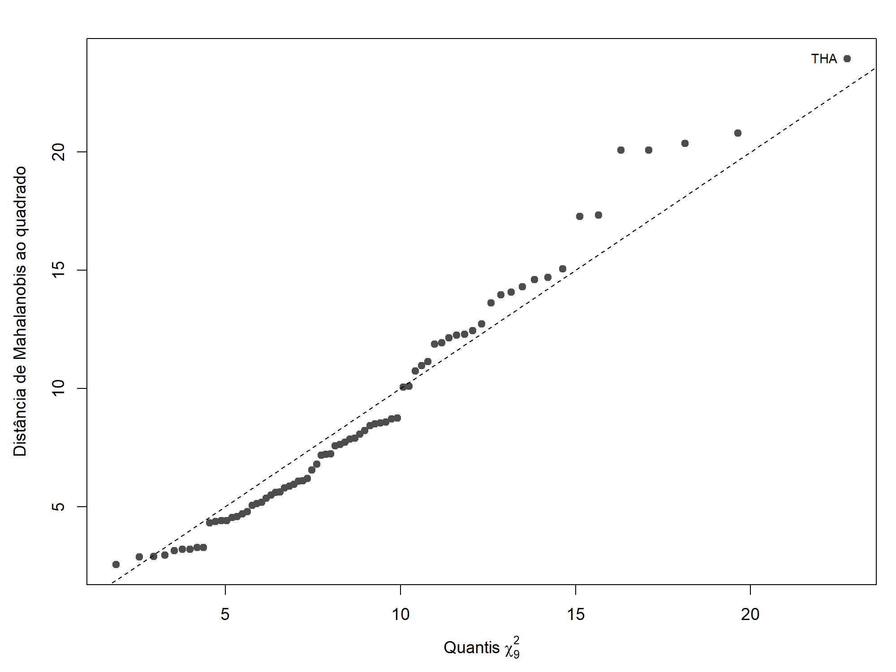

## 4. Diagnósticos antes da ACP

**Tabela 2.** Adequação dos dados à ACP (`t04a`–`t04d`).

| Diagnóstico | Resultado |
|---|---|
| Esfericidade de Bartlett | χ² = 493,3; 36 g.l.; p < 0,001 |
| Mardia, assimetria | $b_{1,p}$ = 22,5; p < 0,001 |
| Mardia, curtose | $b_{2,p}$ = 106,3 contra $E(b_{2,p})$ = 96,4; z = 3,05; p = 0,002 |
| Atípicos ($d^2 > \chi^2_9(0{,}001)$) | nenhum |
| Correlação no gráfico qui-quadrado | 0,99 |

As correlações são suficientes para a redução de dimensão: rejeita-se a esfericidade com folga. As duas variáveis de distração são quase redundantes entre si (r = 0,94). O gráfico qui-quadrado (Figura 2) é aproximadamente linear, com correlação de 0,99 com os quantis teóricos, mas os testes de Mardia rejeitam a normalidade multivariada. Isso justifica usar o bootstrap como referência principal para a incerteza dos autovalores, e não o intervalo 8-33 de JW, que supõe normalidade (Seção 3.3.4). Nenhum país é atípico ao nível de 0,1% ($\chi^2_9(0{,}001) = 27{,}9$). A maior distância é a da Tailândia ($d^2 = 23{,}95$).

**Figura 2.** Gráfico qui-quadrado das distâncias de Mahalanobis dos 74 países (`f02`).
