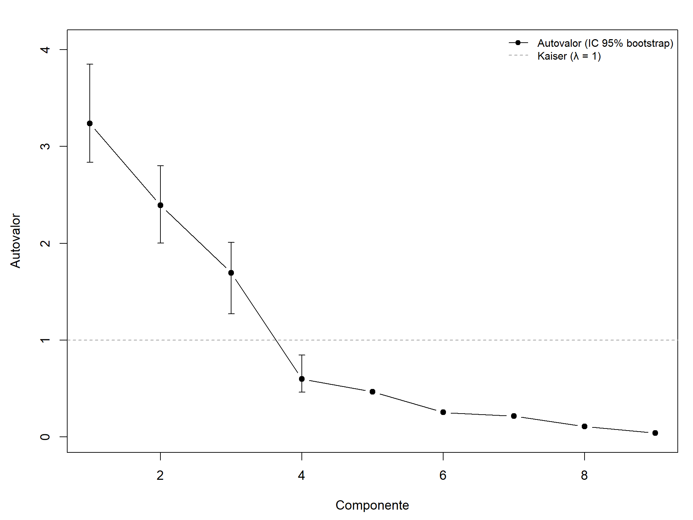
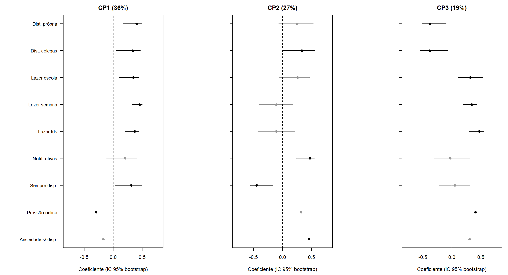

## 5. Componentes principais

### 5.1 Número de componentes

**Tabela 3.** Autovalores, variância explicada e intervalos de 95%: bootstrap percentil e assintótico de JW, Eq. 8-33 (`t05`, `t07a`).

| CP | λ | IC 95% bootstrap | IC 95% (8-33) | % var. | % acum. |
|---|---|---|---|---|---|
| 1 | 3,24 | (2,84; 3,85) | (2,45; 4,78) | 36,0 | 36,0 |
| 2 | 2,39 | (2,00; 2,80) | (1,81; 3,53) | 26,6 | 62,6 |
| 3 | 1,69 | (1,27; 2,01) | (1,28; 2,50) | 18,8 | 81,4 |
| 4 | 0,60 | (0,46; 0,84) | (0,45; 0,88) | 6,6 | 88,0 |

Os elementos recomendados por JW apontam para **K = 3**:

- três autovalores excedem 1, e os intervalos de $\lambda_1$ a $\lambda_3$ ficam inteiramente acima de 1, pelos dois métodos. Os dois intervalos de $\lambda_4$ ficam inteiramente abaixo de 1;
- o gráfico de cotovelo (Figura 3) tem uma queda nítida entre $\lambda_3 = 1{,}69$ e $\lambda_4 = 0{,}60$, e, a partir de $\lambda_4$, os autovalores são todos pequenos (de 0,60 a 0,04) e decrescem suavemente;
- as três componentes explicam 81% da variância, e a quarta acrescentaria apenas 6,6 pontos percentuais;
- as três componentes têm interpretação clara (Seção 5.2).

Os intervalos 8-33 são mais largos e assimétricos para cima, porque a variância assintótica $2\lambda_j^2/n$ cresce com $\lambda_j$. Os intervalos bootstrap são mais estreitos. Os dois não são diretamente comparáveis: a Eq. 8-33 foi derivada para a matriz de covariâncias de uma população normal, e nenhuma das duas condições vale aqui (Seção 3.3.4). As duas abordagens levam à mesma escolha de $K$.

**Figura 3.** Gráfico de cotovelo: autovalores com IC bootstrap de 95% e a linha de referência λ = 1 (`f03`).

### 5.2 Interpretação

**Tabela 4.** Correlações variável–componente e comunalidades (`t06`). Em negrito, $|r| \geq 0{,}5$ antes do arredondamento. Os dois valores −0,50 da CP3 são −0,497 e −0,498.

| Variável | CP1 | CP2 | CP3 | Comunalidade |
|---|---|---|---|---|
| Distrai-se com o próprio dispositivo | **0,73** | 0,39 | −0,50 | 0,93 |
| Distrai-se com dispositivos de colegas | **0,61** | **0,52** | −0,50 | 0,88 |
| Lazer digital na escola | **0,63** | 0,40 | 0,42 | 0,73 |
| Lazer digital em dia de aula | **0,82** | −0,17 | 0,45 | 0,91 |
| Lazer digital no fim de semana | **0,67** | −0,17 | **0,62** | 0,86 |
| Raramente desliga notificações | 0,37 | **0,73** | −0,04 | 0,67 |
| Mantém o aparelho perto para responder | **0,55** | **−0,69** | 0,07 | 0,79 |
| Pressão para estar online | **−0,53** | 0,49 | **0,53** | 0,81 |
| Ansiedade sem o aparelho | −0,31 | **0,71** | 0,40 | 0,75 |

A Figura 4 mostra os coeficientes com IC bootstrap. Em cinza estão os coeficientes cujo sinal não é estável.

**Figura 4.** Coeficientes das três componentes com IC bootstrap de 95% (`f04`, `t07b`).

- **CP1, volume de uso (36%).** Coeficientes positivos e estáveis nas três medidas de horas de lazer e nas duas de distração. Países com escore alto passam mais tempo em telas e relatam mais distração (Bulgária, Estônia, Letônia, Argentina e Hungria). O Japão e o Brunei têm os escores mais baixos.
- **CP2, fragmentação e compulsão (27%).** Notificações ativas e ansiedade sem o aparelho entram com peso positivo e estável, e a distração causada por colegas também. SEMPRE_DISPONIVEL entra com peso negativo. As horas de lazer têm peso próximo de zero. A CP2 isola, portanto, um padrão **independente do volume**: o aluno não desliga o aparelho, sente-se ansioso sem ele e é interrompido. É o construto mais próximo da "infomania" do texto-base e corresponde à "sobrecarga por fragmentação" da Seção 1.3, ao passo que a CP1 corresponde à sobrecarga por volume. O sinal negativo de SEMPRE_DISPONIVEL, que se correlaciona 0,70 com o ESCS, indica que a CP2 também carrega parte do nível de desenvolvimento dos países, ponto retomado na Seção 9.
- **CP3, pressão sem distração (19%).** Contrapõe pressão para estar online e lazer de fim de semana, com pesos positivos, à distração em aula, com peso negativo. Concentra os sistemas do Leste Asiático, onde a distração em aula é rara (5% no Japão, 9% na Coreia), mas a pressão por disponibilidade é alta (35% na Coreia, 44% em Macau).
