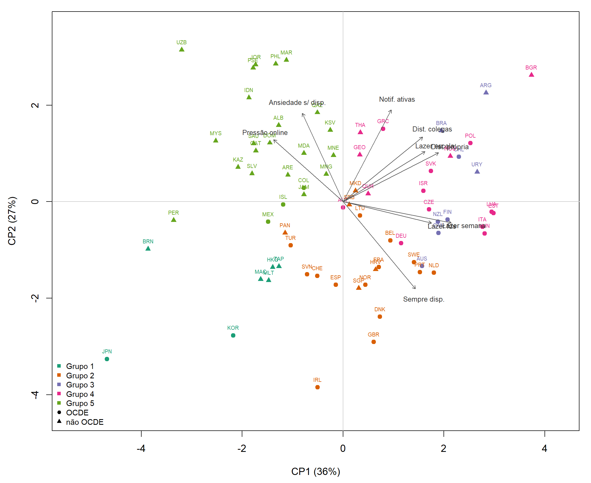

## 6. Perfis de países

### 6.1 Número de grupos e estabilidade

**Tabela 5.** Largura média de silhueta por número de grupos (`t08`).

| G | Silhueta (Ward) | Silhueta (k-médias) | Rand ajustado Ward × k-médias |
|---|---|---|---|
| 2 | 0,263 | 0,285 | 0,70 |
| 3 | 0,262 | 0,273 | 0,73 |
| 4 | 0,314 | 0,325 | 0,75 |
| **5** | 0,295 | **0,329** | 0,73 |
| 6 | 0,264 | 0,310 | 0,72 |

A regra escolhe **G = 5**, embora a diferença em relação a G = 4 seja mínima. A estrutura de grupos é **fraca a moderada**: silhuetas médias próximas de 0,3 indicam que muitos países estão perto da fronteira entre dois grupos, e que os grupos se tocam. O índice de Rand ajustado bootstrap tem média 0,66, com quantil de 5% igual a 0,42 (`t09`). Por isso, os grupos são tratados como uma **partição descritiva de um contínuo**, e não como tipos naturais. As inferências principais (Seções 7.1 e 8) usam os escores contínuos.

### 6.2 Os cinco perfis

**Tabela 6.** Perfil médio dos grupos (`t10`, `t11`).

| Grupo | n | Exemplos | Dist. própria (%) | Lazer semana (h) | Notif. ativas (%) | Pressão (%) | Ansiedade (%) | ESCS | MAT |
|---|---|---|---|---|---|---|---|---|---|
| G1 Baixa distração, alta pressão | 7 | JPN, KOR, TAP, HKG, MAC, MLT, BRN | 12,6 | 2,1 | 20,8 | 36,9 | 24,6 | −0,16 | 515,8 |
| G2 Uso moderado, baixa pressão | 19 | GBR, IRL, DNK, NOR, ESP, FRA, CHE, SGP | 28,0 | 2,5 | 31,4 | 15,2 | 21,2 | −0,01 | 471,8 |
| G3 Alta distração em aula | 8 | ARG, BRA, CHL, URY, FIN, CAN, AUS, NZL | 46,5 | 2,6 | 38,6 | 15,3 | 21,9 | −0,24 | 440,5 |
| G4 Alto volume de lazer | 16 | POL, EST, LVA, HUN, ITA, DEU, CZE, BGR | 31,7 | 3,1 | 39,8 | 24,7 | 29,5 | −0,19 | 456,1 |
| G5 Pressão e ansiedade | 24 | UZB, JOR, PSE, MAR, PHL, IDN, SAU, MEX, PER | 27,9 | 1,8 | 38,1 | 30,2 | 31,3 | −0,69 | 387,3 |

**Figura 5.** Países no plano CP1 × CP2, com as direções das variáveis (`f06`). A Figura `f05` mostra o dendrograma, e a `f07`, os perfis padronizados.

O Brasil está no G3, ao lado de Argentina, Chile e Uruguai, e de quatro sistemas anglo-nórdicos de alto desempenho (Finlândia, Canadá, Austrália e Nova Zelândia). O que une o grupo é a **distração em sala**, a mais alta da amostra: 46,5% contra 29% na média geral. Esse fato é relevante para a política brasileira de restrição de celulares nas escolas (Lei 15.100/2025).
