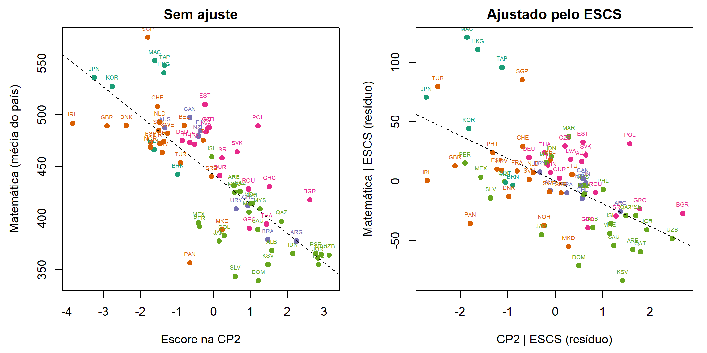

## 7. Dimensões digitais e desempenho

### 7.1 Correlações e regressão multivariada

**Tabela 7.** Correlação dos escores com o desempenho: simples e parcial, dado o ESCS (`t12`).

| | MAT | | LEI | | CIE | |
|---|---|---|---|---|---|---|
| | r | r parcial | r | r parcial | r | r parcial |
| CP1 Volume | 0,23 | −0,01 | 0,35 | 0,17 | 0,29 | 0,09 |
| CP2 Fragmentação | **−0,77** | **−0,60** | **−0,81** | **−0,67** | **−0,80** | **−0,65** |
| CP3 Pressão sem distração | 0,28 | 0,30 | 0,14 | 0,11 | 0,20 | 0,19 |

**Tabela 8.** Regressão multivariada (MAT, LEI, CIE) ~ CP1 + CP2 + CP3 + ESCS. Λ de Wilks por termo (`t13a`) e coeficientes para Matemática (`t13b`).

| Termo | Λ | F (3, 67) | p-valor | Coef. MAT (EP) |
|---|---|---|---|---|
| CP1 | 0,639 | 12,6 | < 0,001 | 4,2 (2,0) |
| CP2 | **0,393** | **34,5** | < 0,001 | **−21,6 (2,8)** |
| CP3 | 0,761 | 7,0 | < 0,001 | 10,8 (2,6) |
| ESCS | 0,772 | 6,6 | < 0,001 | 31,6 (8,8) |

O Λ calculado à mão coincide com o da função `anova.mlm` do R, conferido por `stopifnot`. Somente o ESCS explica 52% da variância de Matemática entre países. Com as três componentes, o R² sobe para **76%** em Matemática, 82% em Leitura e 78% em Ciências, ganhos de 24 a 30 pontos percentuais (`t13c`). Cada unidade de escore na CP2 associa-se, dado o ESCS, a 22 a 25 pontos a menos nas três áreas. Como o desvio-padrão do escore entre países é $\sqrt{\hat{\lambda}_2} = 1{,}55$, um desvio-padrão na CP2 corresponde a 33 a 38 pontos a menos. O volume (CP1) tem efeito pequeno e **positivo**. Esse resultado contraria a ideia de que "mais tela é pior" e concorda com Fournier et al. (2026).

**Figura 6.** Matemática contra o escore na CP2, sem ajuste e ajustado pelo ESCS (gráfico de regressão parcial) (`f09`).

**Diagnóstico.** Os resíduos do modelo multivariado não rejeitam a curtose normal de Mardia (p = 0,36), e a assimetria é rejeitada só marginalmente (p = 0,037) (`t13d`). O gráfico qui-quadrado é linear, com Macedônia do Norte e Mongólia como pontos mais extremos (`f08`). Excluir os países com $d^2 > \chi^2_3(0{,}01)$ altera o coeficiente da CP2 para Matemática de −21,6 para −21,5 (`t16c`).

### 7.2 MANCOVA dos grupos

**Tabela 9.** Efeito dos grupos sobre (MAT, LEI, CIE) (`t14a`, `t14b`).

| Modelo | Λ* | χ² de Bartlett | g.l. | p-valor |
|---|---|---|---|---|
| MANOVA (grupo); JW, Eq. 6-39 | 0,282 | 87,4 | 12 | < 0,001 |
| MANCOVA (grupo, dado o ESCS); JW, Result 7.11 | 0,345 | 72,4 | 12 | < 0,001 |

As médias de Matemática ajustadas para o ESCS médio são: G1 508, G2 455, G4 450, G3 437 e G5 408. Os dois extremos são **G1** (pouca distração, apesar da pressão) e **G5** (alta pressão e ansiedade, com notificações ativas). A diferença ajustada entre eles é de 99 pontos.
