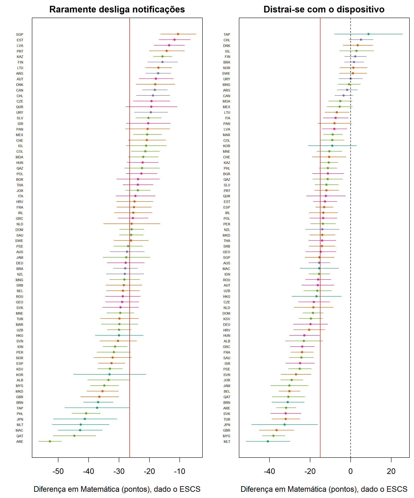

## 8. Entre países e dentro dos países

As Seções 5 a 7 tratam de médias nacionais. A afirmação da reportagem é sobre pessoas: o **aluno** que vive conectado aprende menos do que um colega do mesmo país e do mesmo nível socioeconômico?

**Tabela 10.** Meta-análise das diferenças intrapaís em Matemática, ajustadas pelo ESCS do aluno (`t15a`).

| Comportamento do aluno | Efeito médio (EA) | IC 95% | τ | I² | Negativos signif. | Positivos signif. |
|---|---|---|---|---|---|---|
| Raramente desliga notificações | **−26,5** | (−28,4; −24,6) | 7,9 | 0,90 | **74 de 74** | 0 |
| Distrai-se com o dispositivo | −15,0 | (−17,5; −12,6) | 10,1 | 0,91 | 58 de 74 | 0 |
| Mais de 4 h/dia de lazer digital | **+6,3** | (+4,2; +8,5) | 8,9 | 0,90 | 7 de 74 | 34 de 74 |

**Figura 7.** Diferenças intrapaís com IC 95% (BRR + valores plausíveis). A linha vermelha marca o efeito médio, e as cores indicam os grupos da Seção 6 (`f10`).

Três resultados merecem destaque.

1. **O padrão de notificações é a associação mais universal do estudo.** Nos 74 sistemas, alunos que raramente desligam as notificações em aula têm desempenho inferior, de −10,6 pontos (Singapura) a −52,7 (Emirados Árabes), e nenhum IC inclui o zero. No Brasil a diferença é de −27,9 (EP 2,0). É a regularidade que a reportagem afirmava com base em oito pessoas e que Fournier et al. (2026) observaram em 180 universitários, agora presente em amostras probabilísticas de 74 populações.
2. **Tempo de tela não reproduz o padrão.** Mais de 4 h/dia de lazer digital associa-se a desempenho *maior* em 34 países e menor em apenas 7. Uma parte disso é artefato da dicotomização: o grupo de referência inclui alunos sem nenhum acesso, que tendem a ser os mais pobres, mesmo com o ESCS controlado. A OCDE (2024) descreve uma relação em U invertido com o tempo de lazer digital. De todo modo, o dado é incompatível com uma relação monótona do tipo "mais tela, menos desempenho". Isso é coerente com Fournier et al. (2026), em que o tempo de tela medido objetivamente predisse mal a distração.
3. **A comparação entre países superestima o efeito em cerca de 9 vezes.** Na mesma escala, a passagem de 0% para 100% de alunos com o comportamento, a inclinação entre países (dado o ESCS médio) é de **−242 pontos** (EP 51) para notificações e −121 (EP 46) para distração. Dentro dos países, as estimativas são −26,5 e −15,0 (`t15b`). A diferença é a **falácia ecológica** em forma pura (Seção 3.6.4). A média nacional de notificações ativas carrega tudo o que distingue os países: renda, cultura escolar, qualidade docente e estilo de resposta aos questionários. Interpretar o −242 como efeito sobre o aluno seria um erro grave.

A heterogeneidade é alta (I² ≈ 0,90). O efeito das notificações é maior no G1 (−37,7), onde desligar o aparelho é a norma e quem não o faz destoa mais, e no G5 (−28,9) (`t15c`).
